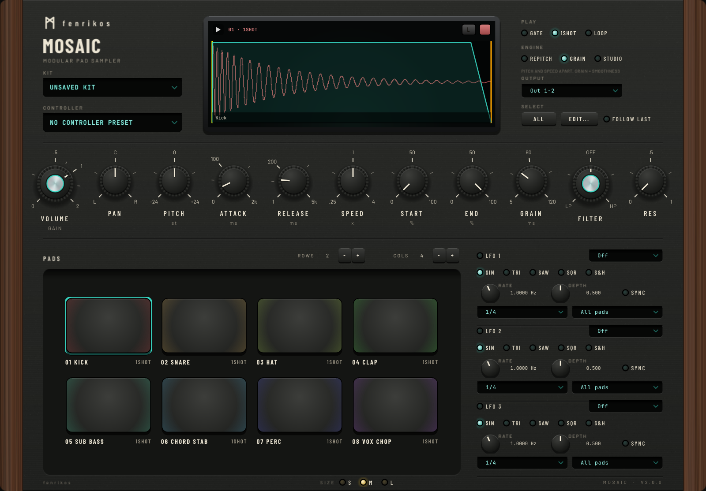

<div align="center">
  
  <h1>MOSAIC</h1>
  <p><b>A dynamic modular sampler plugin: map any hardware pad controller, drop in samples, and play.</b></p>
</div>

<div align="center">
  
</div>

MOSAIC turns your Launchpad, LPD8 or any MIDI pad grid into a colour-coded, fully
modular sampler. Build a grid of up to 8×8 pads, drag a sample onto each, pick how
it triggers, shape it, modulate it, and route pads to separate outputs — all in a
compact, good-looking interface.

Formats: **VST3**, **AU**, **Standalone** · Windows & macOS (universal) · Linux (VST3/Standalone)

---

## Features

- **Dynamic pad grid** — from 1×1 up to 8×8; the window grows with the grid so pads keep a playable size, and the
  **SIZE** switch (S / M / L) scales the whole panel to 80, 100 or 125 %.
- **Drag & drop** `.wav` / `.mp3` / `.aif` onto a pad (or double-click it to pick one). The screen shows the selected
  pad's waveform with draggable trim handles, the envelope and the playhead; the sample name is printed under the pad.
- **Three trigger modes per pad** — Momentary (gate), Latching (one-shot), Looping (tap to toggle).
- **Three pitch/time engines per pad.** They only differ once you change **Pitch** or **Speed**; at Pitch 0 and
  Speed 1 every engine plays the sample untouched.
  - **Repitch** — like tape: pitch and speed move together (higher = faster and shorter). Simplest, no artefacts.
  - **Granular** — pitch and speed move independently, built from overlapping grains; the **Grain** knob sets
    their length (short = tighter but rougher, long = smoother). Light on CPU, a little gritty.
  - **Studio** — pitch and speed move independently with the cleanest result (Signalsmith Stretch). Heavier on CPU.
- **Sound shaping** — Volume, Pan, Pitch (±24 st), Speed (0.25–4×), Attack, Release, with the envelope drawn over the waveform.
- **One-knob filter per pad** — centre is off, turn left for a low-pass (darker), right for a high-pass (thinner);
  **Res** adds a peak at the cutoff.
- **3 global LFOs** — Sine/Tri/Saw/Square/S&H, free or **tempo-synced**, routable to Volume / Pan / Pitch / Speed on all pads or the selected pad.
- **Multi-out routing** — send pads to up to 8 stereo outputs for per-pad mixing.
- **MIDI learn** — map a note to each pad; map hardware CC knobs to the inspector controls.
- **Two kinds of preset.** A **kit** holds the samples, colours and sound of every pad, the grid and the LFOs; a
  **controller** preset holds which note plays each pad and which CC moves each knob. Switch kits without losing
  your hardware mapping, or swap controllers without touching the sound.
- **Multi-select & bulk edit**, **custom pad colours**, **playback cursor** and **"follow last played"**.
- **Missing samples are never lost silently.** If a project refers to samples you have moved, their pads show
  MISSING and keep the path; Edit → *Relink missing samples* finds them in a folder you choose.
- **Responsive:** dropped samples decode in the background, so the window never freezes.

## Download

Grab the zip for your system from the [Releases](../../releases) page:
`MOSAIC-<version>-Windows-x64.zip`, `MOSAIC-<version>-macOS.zip` (universal) or `MOSAIC-<version>-Linux-x64.zip`.
Each contains the plugin, the Standalone app and a README with the install steps.

### Installing
- **Windows:** copy `MOSAIC.vst3` to `C:\Program Files\Common Files\VST3`.
- **macOS:** copy `MOSAIC.vst3` to `/Library/Audio/Plug-Ins/VST3` and `MOSAIC.component` to `/Library/Audio/Plug-Ins/Components`.
  The builds are not notarised; the README in the zip has the one Terminal command that unblocks them.
- **Linux:** run `./install.sh` from the unzipped folder.
- Or just run the **Standalone** app.

## Build from source

```bash
cmake -B build -S . -DCMAKE_BUILD_TYPE=Release
cmake --build build --config Release --parallel
```

JUCE and Signalsmith Stretch are fetched automatically by CMake (internet required on the first configure).
Pass `-DJUCE_DIR=/path/to/JUCE` to use a local JUCE checkout instead. Useful options:

| Option | Default | |
|---|---|---|
| `MOSAIC_TESTS` | ON | Builds `MOSAICTests` (missing-sample handling and relinking) |
| `MOSAIC_LTO` | ON | Link-time optimisation; turn off for faster development builds |
| `MOSAIC_SNAPSHOT` | OFF | Builds `MOSAIC_snapshot`, which renders the editor to PNG |

### Releasing
The **Build** workflow builds Windows, macOS and Linux, runs the unit tests, pluginval and auval, and packages
a zip per platform. Run it from the Actions tab, or push a `v*` tag to also publish a GitHub Release with the
zips and the matching section of `packaging/CHANGELOG.txt`.

## Licensing

MOSAIC is released under the **GNU AGPLv3** (see [LICENSE](LICENSE)). It builds on
**JUCE** (used here under its AGPL option) and **Signalsmith Stretch** (MIT) —
see [THIRDPARTY.md](THIRDPARTY.md). Under AGPLv3 you may use, modify and sell
builds of MOSAIC, provided the complete corresponding source is made available
to recipients under the same licence.

© Ioannis Bouritis.
